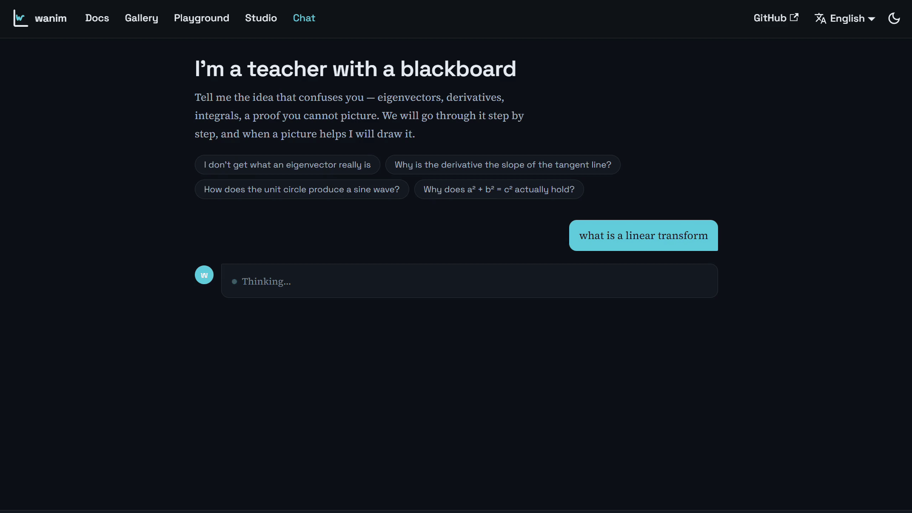
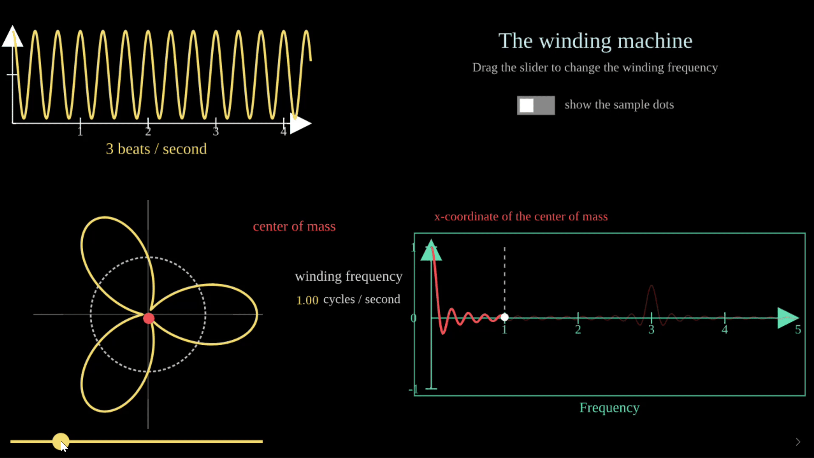
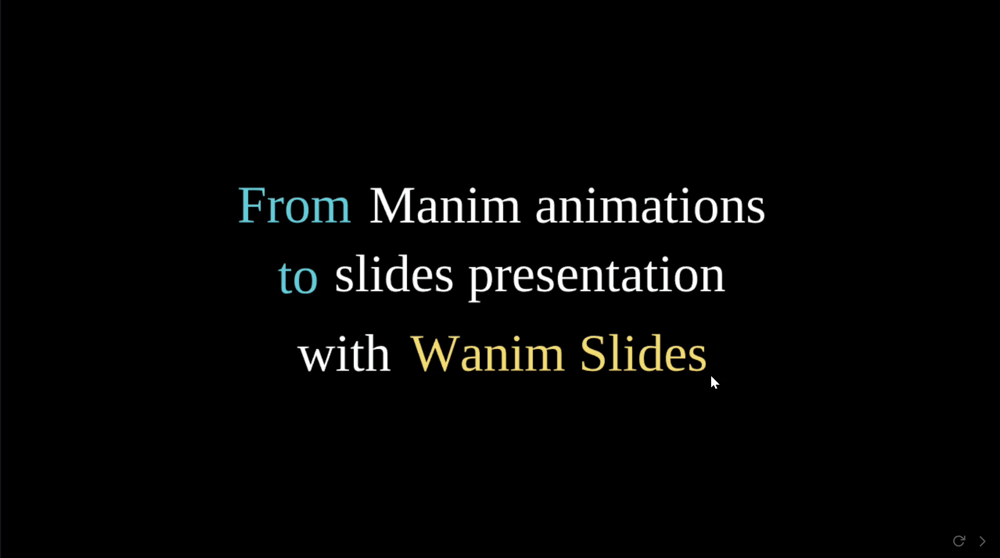

<p align="center">
  <picture>
    <source media="(prefers-color-scheme: dark)" srcset="assets/wanim-title-dark.svg">
    
  </picture>
</p>

<p align="center">
  <b>Build playable math with <a href="https://www.manim.community">ManimCE's API</a>, and embed it anywhere.</b><br>
  Wanim lets almost unmodified manim Python run
in the browser lightweightly, and turns those scenes into interactive presentations with only minor code
changes.
</p>
<p align="center">
  <a href="https://wanim.org/docs/intro">Documentation</a> ·
  <a href="https://wanim.org/playground">Playground</a> ·
  <a href="https://wanim.org/docs/gallery">Examples</a> ·
  <a href="https://wanim.org/chat/">Embedded in chat</a>
</p>

<p align="center">
  <a href="https://wanim.org/chat/"></a>
  <a href="https://wanim.org/playground/?id=4be3ae8d&show=1"></a>
  <a href="https://wanim.org/playground/?id=bfa1cf5e&show=1"></a>
 
</p>


## Why Wanim？

- Run the original manim Python in the browser. 
- Small enough to embed anywhere: **About 20× smaller than Pyodide-based ways of running manim in the browser.** Your readers install nothing, and a scene drops into any page as a <wanim-scene> element or an iframe. In the age of AI, that means live math can sit inside a conversation with a model, or serve as the blackboard the AI draws on while it explains.
- Interactive with a few small edits. Turn an ordinary manim animation into an explorable explanation: add a slider, a switch, or a numeric input, wire up a reaction, and readers can drag, type, and toggle their way through the idea instead of just watching it go by.

## Comparison

| Capability | **Wanim** | [manim-web](https://github.com/maloyan/manim-web) | [try.manim.community](https://try.manim.community/) | [studio.academa.ai](https://studio.academa.ai/) |
| --- | :---: | :---: | :---: | :---: |
| Runs the original manim Python code | ✅ | ❌ | ✅ | ✅ |
| Lightweight, embeddable anywhere | ✅ | ✅ | ❌ | ❌ |
| Real-time rendering in the browser | ✅ | ✅ | ❌ | ✅ |
| Interactive demos and slides | ✅ | ❌ | ❌ | ❌ |

## Quick start

### In the browser — nothing to install

Open the [playground](https://wanim.org/playground), pick an example, and press
**Run** (Ctrl+Enter). Every example is real manim Python you can edit and re-run
instantly; more ready-made scenes live in the
[gallery](https://wanim.org/docs/gallery).

Happy with a scene? Press **Share**: the dialog hands you a short link to the
editor, a full-screen presentation link (`?show=1`, with replay and keyboard
shortcuts), and a ready-to-paste iframe snippet for embedding the animation in
any page.

### In a bundled app (Vite, webpack, esbuild, Rollup)

```bash
npm install @wanimjs/wanim
```

Node.js 18 or newer is needed when using the package from Node. 

```js
import { runPythonOnCanvas } from "@wanimjs/wanim/bridge";

const source = `
from manim import *

class Hello(Scene):
    def construct(self):
        self.play(Write(Text("Hello, Wanim!")))
        self.wait(0.5)
`;

await runPythonOnCanvas(source, document.querySelector("canvas"), {
  quality: "-qm",   // 1280 x 720 at 30 fps
  realtime: true,
});
```

### With the `<wanim-scene>` element (no page script)

Map `numpy-ts` in an import map, load the element bundle, and put Python in the
tag:

```html
<script type="importmap">
{
  "imports": {
    "numpy-ts": "https://cdn.jsdelivr.net/npm/numpy-ts/dist/numpy-ts.browser.js"
  }
}
</script>
<script type="module" src="https://cdn.jsdelivr.net/npm/@wanimjs/wanim/browser/wanim-element.browser.js"></script>

<wanim-scene quality="-qm">
  <script type="text/x-python">
from manim import *

class Demo(Scene):
    def construct(self):
        self.play(Create(Circle()))
  </script>
</wanim-scene>
```

Serving the files yourself works the same way: copy the package's `browser/`
directory (keep its `chunks/` subdirectory) and `numpy-ts.browser.js` from
`node_modules/numpy-ts/dist/` onto your site, then point the URLs at them.

For the full `<wanim-scene>` and javascript API, see the [documentation](https://wanim.org/docs/usage).

## Interactive scenes

```python
from manim import *

class Interactive(InteractiveScene):
    def blueprint(self):
        axes = Axes(x_range=[-1, 8, 1], y_range=[-2, 2, 1], x_length=8, y_length=4)
        circle = Circle(radius=0.5, color=BLUE, fill_opacity=0.6)

        slider = Slider(
            start=axes.c2p(1, -1.6), end=axes.c2p(7, -1.6),
            value_range=(0.4, 2.5), init_value=1.0, color=YELLOW,
        )
        circle.add_reaction(lambda m: m.set_width(slider.get_value()))

        switch = Switch(True).to_corner(UR, buff=0.8)
        circle.add_reaction(lambda m: m.set_color(GREEN if switch.get_value() else RED))

        self.add(axes, circle, slider, switch)

    def construct(self):
        hint = Text("Drag the slider, flip the switch", font_size=24)
        self.play(FadeIn(hint.to_edge(DOWN)), run_time=0.8)
        self.wait(0.5)
```

Controls are ordinary mobjects, so they can be positioned and animated like any
other:

| Control | Reader interaction | `get_value()` returns |
| --- | --- | --- |
| `Slider(start, end, value_range, init_value)` | drag along a segment | `float` |
| `PathSlider(path, value_range, is_closed)` | drag along any curve | `float` |
| `Switch(value)` | click to toggle | `bool` |
| `InputDecimalNumber(value, num_decimal_places)` | type, or drag to scrub | `float` |
| `InputInteger(value)` | type, or drag to scrub | `int` |
| `InputDecimalMatrix(rows)` | edit cells; layout adjusts | cell values |
| `InputDecimalTable(rows)` | edit cells; grid rebuilds | cell values |

Other features:

- `add_reaction` callbacks run once when a blueprint page is entered and again
  after any reader input; an idle page is re-rendered without recomputing the
  model.
- `control.on_input(fn)` observes value changes from gestures, text edits and
  drags; it also fires once per control when the player restores remembered
  values on "previous"/replay.
- `set_storyboard([[blueprint, construct], ...])` gives multi-step stories.
- The embedder chooses pacing: `<wanim-scene mode="slides">` pauses after
  every segment for lecture-style material, while `mode="two-view"` loops the
  animation and lets readers double-click into the live controls.
- In two-view mode a paired blueprint/construct loops as one animation; set
  `SEPARATE = True` on the class to keep the two halves independent, or call
  `self.clear_stage()` at the end of a blueprint to start the construct on an
  empty canvas while still reading control values.
- `self.post_message(key, value)` emits a `wanim-message` event to the page,
  and `self.theme` is `"light"` / `"dark"` when the host supplies it.
- Scenes that pause show previous, replay, and next controls. Keys:
  `Space` or `→` next, `←` previous, `↑` replay.
- `ThreeDScene` and `InteractiveThreeDScene` support drag-to-orbit and scroll
  to zoom in idle blueprints.


## Development

Prerequisites: Node.js 20 or newer and [pnpm](https://pnpm.io/).

```bash
git clone https://github.com/Acfboy/Wanim.git
cd Wanim
pnpm install
pnpm build:demo    # build the runtime, patched rapydscript-ng, element, and editor
pnpm demo          # editor at http://localhost:5174/demo/
```

`build:demo` clones rapydscript-ng at a pinned commit and applies
`py2js/patches/rapydscript-ng.patch`, so the first build needs network access.

| Command | Purpose |
| --- | --- |
| `pnpm build` | compile the library to `dist/` |
| `pnpm build:packages` | assemble the npm package in `packages-out/` |
| `pnpm test` | library tests (Vitest) |
| `pnpm test:py2js` | preprocessor, compiler-error, and runtime tests |
| `pnpm typecheck` | TypeScript check without emitting |


## Acknowledgements

Wanim wouldn't exist without the work of others. Thanks to [3Blue1Brown](https://www.3blue1brown.com/) for creating manim and for the videos that made so many of us want to explain math this way in the first place; to everyone in the [Manim Community](https://www.manim.community/) who built and maintained the API Wanim follows; to [numpy-ts](https://numpyts.dev/) for the numpy layer; and to [rapydscript-ng](https://github.com/kovidgoyal/rapydscript-ng) for the Python-to-JavaScript compiler we patch.

## License

MIT. Third-party dependencies keep their own licences: numpy-ts (MIT),
MathJax (Apache-2.0), opentype.js (MIT), and rapydscript-ng (BSD-2-Clause) for
the patched compiler.
