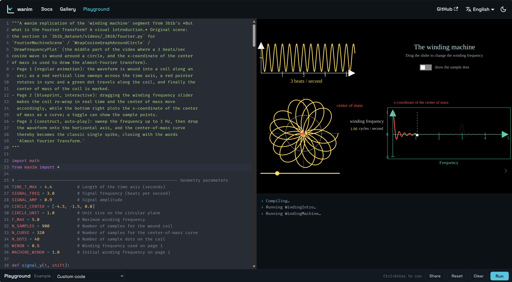

# Wanim

**manim, live in the browser — lightweight, fast, and interactive.**
Wanim lets almost unmodified [manim](https://www.manim.community/) Python run
in the browser—lightweight, fast, and convenient—and with only minor code
changes, turns those scenes into interactive presentations far more powerful
than plain animation. Nothing for your readers to install: no Python, no
LaTeX, no server, and no tens-of-megabytes Pyodide runtime. See examples in
our [gallery](https://wanim.org/docs/gallery) and try it yourself in the
[playground](https://wanim.org/playground).

[](https://wanim.org/playground?id=4be3ae8d&show=1)
_A recreation of 3b1b's stunning Fourier transform visualization_, [click to try it live.](https://wanim.org/playground?id=4be3ae8d&show=1)

Full documentation starts at [wanim.org/docs/intro](https://wanim.org/docs/intro).

## Features

- **Stock manim API.** `Scene`, mobjects, `self.play`, `.animate`,
  `ValueTracker`, `Transform`, `MathTex`, `ThreeDScene`, and the rest of the
  common surface keep their Python names and keyword arguments.
- **Real-time playback** on a Canvas2D backend. `self.wait()` is a real pause.
- **Interactive scenes.** `InteractiveScene` separates a live `blueprint()`
  (controls and input-driven reactions) from `construct()` (an ordinary
  animation script the reader advances to).
- **Math and text without LaTeX.** `MathTex` and `Tex` use MathJax, loaded on
  demand. Text uses open-licensed fonts.
- **Embeddable.** A `<wanim-scene>` custom element, a code-in-URL iframe, and
  a JavaScript API.

## Comparison

| Capability | **Wanim** | [manim-web](https://github.com/maloyan/manim-web) | [try.manim.community](https://try.manim.community/) | [studio.academa.ai](https://studio.academa.ai/) |
| --- | :---: | :---: | :---: | :---: |
| Runs the original manim Python code | ✅ | ❌ | ✅ | ✅ |
| Lightweight, embeddable anywhere | ✅ | ✅ | ❌ | ❌ |
| Real-time rendering in the browser | ✅ | ✅ | ❌ | ✅ |
| Interactive demos and slides | ✅ | ❌ | ❌ | ❌ |

## Installation

```bash
npm install @wanimjs/wanim
```

Node.js 18 or newer is needed when using the package from Node. The embed
helpers need a browser with `CompressionStream` (current Chrome, Edge,
Firefox, and Safari).

## Quick start

### In the browser — nothing to install

Open the [playground](https://wanim.org/playground), pick an example, and press
**Run** (Ctrl+Enter). Every example is real manim Python you can edit and re-run
instantly; more ready-made scenes live in the
[gallery](https://wanim.org/docs/gallery).

Happy with a scene? Press **Share**: the dialog hands you a short link to the
editor, a full-screen presentation link (`?show=1`, with replay and keyboard
shortcuts), and a ready-to-paste iframe snippet for embedding the animation in
any page.

### In a bundled app (Vite, webpack, esbuild, Rollup)

```js
import { runPythonOnCanvas } from "@wanimjs/wanim/bridge";

const source = `
from manim import *

class Hello(Scene):
    def construct(self):
        self.play(Write(Text("Hello, Wanim!")))
        self.wait(0.5)
`;

await runPythonOnCanvas(source, document.querySelector("canvas"), {
  quality: "-qm",   // 1280 x 720 at 30 fps
  realtime: true,
});
```

### With the `<wanim-scene>` element (no page script)

Map `numpy-ts` in an import map, load the element bundle, and put Python in the
tag:

```html
<script type="importmap">
{
  "imports": {
    "numpy-ts": "https://cdn.jsdelivr.net/npm/numpy-ts/dist/numpy-ts.browser.js"
  }
}
</script>
<script type="module" src="https://cdn.jsdelivr.net/npm/@wanimjs/wanim/browser/wanim-element.browser.js"></script>

<wanim-scene quality="-qm">
  <script type="text/x-python">
from manim import *

class Demo(Scene):
    def construct(self):
        self.play(Create(Circle()))
  </script>
</wanim-scene>
```

Serving the files yourself works the same way: copy the package's `browser/`
directory (keep its `chunks/` subdirectory) and `numpy-ts.browser.js` from
`node_modules/numpy-ts/dist/` onto your site, then point the URLs at them.

## Interactive scenes

```python
from manim import *

class Interactive(InteractiveScene):
    def blueprint(self):
        axes = Axes(x_range=[-1, 8, 1], y_range=[-2, 2, 1], x_length=8, y_length=4)
        circle = Circle(radius=0.5, color=BLUE, fill_opacity=0.6)

        slider = Slider(
            start=axes.c2p(1, -1.6), end=axes.c2p(7, -1.6),
            value_range=(0.4, 2.5), init_value=1.0, color=YELLOW,
        )
        circle.add_reaction(lambda m: m.set_width(slider.get_value()))

        switch = Switch(True).to_corner(UR, buff=0.8)
        circle.add_reaction(lambda m: m.set_color(GREEN if switch.get_value() else RED))

        self.add(axes, circle, slider, switch)

    def construct(self):
        hint = Text("Drag the slider, flip the switch", font_size=24)
        self.play(FadeIn(hint.to_edge(DOWN)), run_time=0.8)
        self.wait(0.5)
```

Controls are ordinary mobjects, so they can be positioned and animated like any
other:

| Control | Reader interaction | `get_value()` returns |
| --- | --- | --- |
| `Slider(start, end, value_range, init_value)` | drag along a segment | `float` |
| `PathSlider(path, value_range, is_closed)` | drag along any curve | `float` |
| `Switch(value)` | click to toggle | `bool` |
| `InputDecimalNumber(value, num_decimal_places)` | type, or drag to scrub | `float` |
| `InputInteger(value)` | type, or drag to scrub | `int` |
| `InputDecimalMatrix(rows)` | edit cells; layout adjusts | cell values |
| `InputDecimalTable(rows)` | edit cells; grid rebuilds | cell values |

Other features:

- `add_reaction` callbacks run once when a blueprint page is entered and again
  after any reader input; an idle page is re-rendered without recomputing the
  model.
- `set_storyboard([[blueprint, construct], ...])` gives multi-step stories.
- `wanim_config({"slides_mode": True})` pauses after every segment, for
  lecture-style material.
- Scenes that pause show previous, replay, and next controls. Keys:
  `Space` or `→` next, `←` previous, `↑` replay.
- `ThreeDScene` and `InteractiveThreeDScene` support drag-to-orbit and scroll
  to zoom in idle blueprints.

## Embedding

- **`<wanim-scene>`** attributes: `code` or child `<script type="text/x-python">`,
  `src`, `quality` (`-ql`, `-qm`, `-qh`, `-q4k`), `fps`, `scene`, `background`,
  `autoplay`, `loop`, `preload-modules` (`mathjax fonts`). Methods: `run()`,
  `stop()`, `next()`, `previous()`, `replay()`, `restart()`. Events:
  `wanim-ready`, `wanim-run`, `wanim-scene`, `wanim-done`, `wanim-error`.
- **Code in the URL fragment** for CMSs that accept only an iframe:

  ```js
  import { build_embed_hash, build_embed_iframe } from "@wanimjs/wanim";

  const hash = await build_embed_hash(pythonSource, { quality: "-qm" });
  const html = build_embed_iframe(`https://wanim.org/embed.html${hash}`, {
    width: 960, height: 540, title: "Square to circle",
  });
  ```

  The fragment is deflate-compressed and never sent to a server. The player
  page is `demo/embed.html` in this repository; copy it as a starting point.

## Package entry points

| Import | Contents | Environment |
| --- | --- | --- |
| `@wanimjs/wanim` | manim-compatible library, scenes, embed helpers | Node, bundlers |
| `@wanimjs/wanim/py2js` | Python to JavaScript compiler helpers | Node-safe |
| `@wanimjs/wanim/py-runtime` | rapydscript shims, `math`/`random`/`itertools` facades | Node-safe |
| `@wanimjs/wanim/bridge` | `runPythonOnCanvas`, `benchInteractiveScene` | Browser |
| `@wanimjs/wanim/browser/*` | prebuilt bundles (`element`, `rapydscript`, and others) | Browser |

Supported Python imports are `manim`, `numpy` (mapped to numpy-ts), `random`,
`math`, and `itertools`. Other imports fail with a readable error at compile
time.

## Compatibility notes

- The API follows manim Community Edition v0.21. Where behaviour differs, the
  test suite is the reference. Please open an issue with the scene if
  something runs under manim but not here.
- Output is a live `<canvas>`. Wanim does not write video files.
- Math uses MathJax, not LaTeX. Common `MathTex` input works; unusual LaTeX
  packages do not.
- Glyph coverage depends on the fonts you configure. Fonts can be self-hosted
  with `configure_fonts([...])`, called before the first scene runs.
- Some relatively complex numpy usage is not supported yet. If you hit a common
  pattern that should work, please open an issue.

## Development

Prerequisites: Node.js 20 or newer and [pnpm](https://pnpm.io/).

```bash
git clone https://github.com/Acfboy/Wanim.git
cd Wanim
pnpm install
pnpm build:demo    # build the runtime, patched rapydscript-ng, element, and editor
pnpm demo          # editor at http://localhost:5174/demo/
```

`build:demo` clones rapydscript-ng at a pinned commit and applies
`py2js/patches/rapydscript-ng.patch`, so the first build needs network access.

| Command | Purpose |
| --- | --- |
| `pnpm build` | compile the library to `dist/` |
| `pnpm build:packages` | assemble the npm package in `packages-out/` |
| `pnpm test` | library tests (Vitest) |
| `pnpm test:py2js` | preprocessor, compiler-error, and runtime tests |
| `pnpm typecheck` | TypeScript check without emitting |

### Layout

```
src/          manim-compatible library (mobject, animation, scene, interactive, renderer)
py2js/        Python to JavaScript bridge and rapydscript-ng patch
demo/         editor and iframe player
scripts/      bundling, packaging, and demo server
packaging/    package.json, README, and LICENSE for the npm package
tests/        Vitest suites
```

## Contributing

Bug reports and minimal failing scenes are the most useful contribution right
now. Open an issue with the Python source, the expected output, and what Wanim
does instead. Before opening a pull request, run `pnpm typecheck`, `pnpm test`,
and `pnpm test:py2js`.

## License

MIT. Third-party dependencies keep their own licences: numpy-ts (MIT),
MathJax (Apache-2.0), opentype.js (MIT), and rapydscript-ng (BSD-2-Clause) for
the patched compiler.
